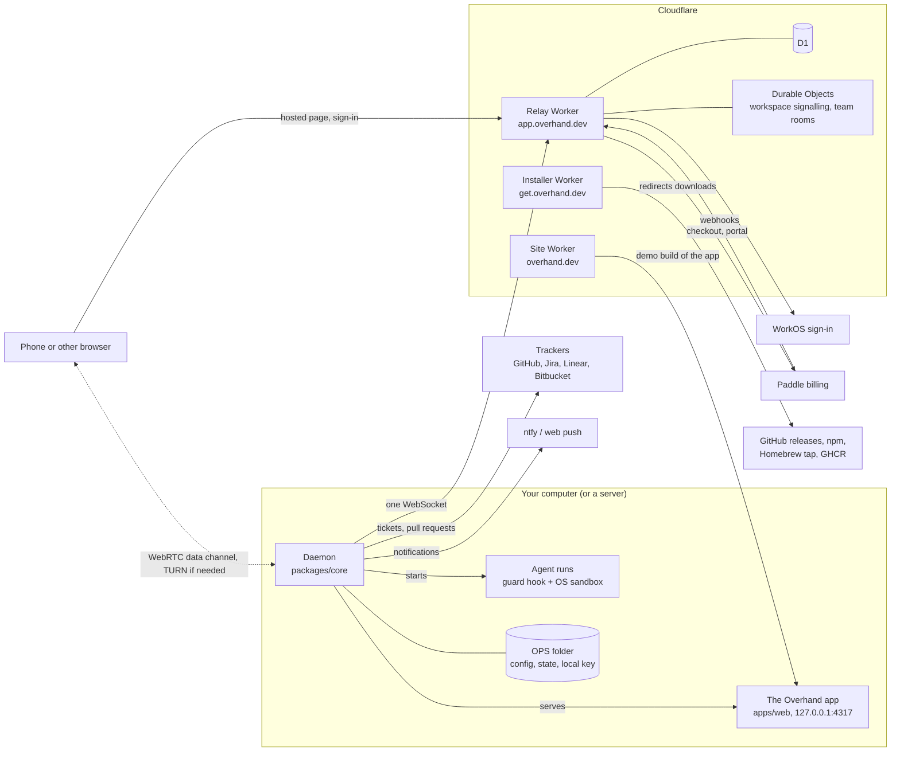

# Architecture

How Overhand fits together, in five minutes. Folder by folder detail lives in [AGENTS.md](../AGENTS.md) and
[packages/core/AGENTS.md](../packages/core/AGENTS.md); setup and checks in [CONTRIBUTING.md](../CONTRIBUTING.md).

## The daemon

`packages/core`, started by `run.ts` (`overhand daemon`, kept alive by launchd or systemd). It never listens beyond
loopback: the app's server (`src/server.ts`) binds `127.0.0.1:4317` by default.

- **OPS folder.** `OVERHAND_HOME`, else `~/.overhand` for the installed binary (`src/env.ts`). It holds
  `overhand.config.json`, `state.json`, run outboxes and `control/`. Mode 0700.
- **Local key.** `control/local-key` signs a browser on this machine in (`overhand open`), and Overhand's own CLI sends
  it in a header. Other browsers pair as devices (`src/devices.ts`).
- **Main loop.** `src/daemon.ts`: a daily plan, inbox passes on `config.schedule`, then the queue; minute ticks for
  leads, updates, reports and the governor; a self check; automatic cleanup every ten minutes when it is due and
  nothing is running.
- **Tickets and runs.** `src/agent.ts` reads labelled tickets through `src/trackers/` (one interface in `types.ts`),
  routes each to a repo, works it in a worktree and opens a pull request. Agent CLIs plug in through `src/runtimes/`.
- **Leads.** `src/leads.ts` supervises long-running agent sessions; see [docs/leads.md](leads.md).
- **Guard hook.** `src/guard.ts` is the hook every agent tool call passes (`overhand guard`); `src/agent-home.ts`
  installs it, `src/guard-dialects.ts` speaks each CLI's hook format. Coverage per agent: `/docs/guard` on the site.
- **Operating system sandbox.** `src/sandbox.ts`: `sandbox-exec` on macOS, bubblewrap on Linux. Design:
  [docs/specs/2026-10-23-agent-sandbox-design.md](specs/2026-10-23-agent-sandbox-design.md).
- **Cleanup.** `src/cleanup.ts` plans, then removes only ticked items; the caches it knows are in
  [docs/cleanup-sources.md](cleanup-sources.md).
- **Notifications.** `src/notify.ts` posts to ntfy when `ntfySecret` is set; `src/webpush.ts` sends web push itself.

## The app

`apps/web`, React. The daemon serves its build (`apps/web/dist`) and `/api/state`. The same build is the hosted page on
app.overhand.dev, reaching the daemon over WebRTC. With `?demo` it runs on the sample data in `apps/web/src/demo`: the
site copies that build to `/demo` and embeds it on the landing page. `apps/design` is the design catalog at
`/docs/design`.

On a Mac the daemon also starts the menu bar item (`src/menubar.ts`): `apps/menubar`, a small Swift helper that shows
the mark and the count of what needs you, and holds the app's `glance.html` page in a popover. It never reads the local
key: the daemon hands it a signed-in address over its stdin, and opens anything it asks for in the browser. The release
workflow builds it on a Mac, for Apple silicon and Intel, into the Mac packages.

## Shared packages

- `packages/contract` (Apache-2.0): the typed API between the daemon and the app (Zod), links, features and the
  `CLAIMS` the site makes (`guard.ts`, `sandbox.ts`).
- `packages/themes` (Apache-2.0): colours, type, the brand mark and every word in `src/words.ts`.

## The relay

`relay/`, one Cloudflare Worker on app.overhand.dev, deployed by hand with wrangler. It signs people in through WorkOS,
links a daemon to an account, signals WebRTC through a Durable Object per workspace, hands out TURN credentials,
issues entitlement tokens, runs Paddle billing and its webhooks, and hosts teams (a `TeamRoom` Durable Object per team,
data in D1), and runs hosted runs on Cloudflare Containers (behind a switch, staging only for now). The app's traffic never passes through it. The full flow, migrations and owner setup:
[relay/README.md](../relay/README.md); teams: [docs/teams.md](teams.md); cost: [relay/COST.md](../relay/COST.md).

## The site and the installer

- `site/`: the Worker `overhand-site` on overhand.dev. `site/build.ts` renders `site/pages` and writes `llms.txt`,
  `llms-full.txt`, Markdown copies of each docs page and `/skill.md` (from `skills/overhand/SKILL.md`).
- `site/get`: the Worker `overhand-get` on get.overhand.dev. It serves `release/install.sh` and redirects
  `/download/...` to the GitHub release files, or says "not public yet" while no release is out.

## Staging and production

| Part | Production | Staging (`--env staging`) |
| --- | --- | --- |
| Site | overhand.dev | staging.overhand.dev, kept out of search engines, links to the staging app |
| Relay | app.overhand.dev, live Paddle, production WorkOS | staging-app.overhand.dev, its own D1 and signing key, Paddle sandbox, staging WorkOS |
| Installer | get.overhand.dev | none |

Relay changes go to staging first. Both are set in `relay/wrangler.jsonc` and `site/wrangler.jsonc`.

## Docker and servers

The `Dockerfile` builds the release binary for Linux and runs it as a non-root user, all state on one volume, still on
loopback only. How to reach it: `/docs/server` on the site (`site/pages/docs/server.html`). `release/server` holds the
ready-made setups for your own server, served by the site under `/server/`: `user-data.sh`, a first-boot script that
runs the installer as a user service, and `compose.yml`, the published image on the host network
(`release/server.test.ts` keeps both on the same facts).

## How a release goes out

Bump `version` in a pull request, merge, then `bun release/launch.ts` on `main`
([CONTRIBUTING.md](../CONTRIBUTING.md#releasing) lists every step):

1. The tag `vX.Y.Z` starts `.github/workflows/release.yml`: `release/build.ts` packages every platform, a smoke test,
   then a GitHub release with `SHA256SUMS`, then the npm launcher in `release/npm`.
2. `launch.ts` deploys the installer and the site, installs from get.overhand.dev into a scratch home, checks
   `npx overhand`, pushes the Homebrew formula (`release/formula.ts`) and pushes the Docker image to GHCR.

When the npm job needs another go after a fix, run the `npm-publish` workflow by hand with the tag.

## Checks on every pull request

- `ci.yml`, job `checks`: brand files unchanged, `tsc`, Biome, jscpd (`.jscpd.json`, no copy-pasted code), the tests
  (`bun run test`, the sandbox inside real bubblewrap), the app build, `release/smoke.sh`. The tests include
  `release/dupes.test.ts` (no sentence written twice) and `release/shots.test.ts`; the full responsive sweep
  (`bun run shots`) runs locally and in release preflight.
- `leakcheck.yml`: `release/leakcheck.ts` against a deny-list; forks skip it.
- `docker.yml`, job `image`: `release/docker-check.sh`, when the image or the code it runs changes.

## Secrets, by name

- **Repository secrets:** `PUBLIC_DENYLIST` (the leak check). Releases use the built-in `GITHUB_TOKEN`, and npm takes
  the release workflow's own identity (trusted publishing), so no npm token is stored.
- **Relay Worker secrets,** set per environment with `wrangler secret put`: `SIGNING_KEY`, `WORKOS_API_KEY`,
  `TURN_KEY_API_TOKEN`, `PADDLE_API_KEY`, `PADDLE_WEBHOOK_SECRET`. Public vars sit in `relay/wrangler.jsonc`; every
  name is described in `relay/.env.example`.
- **Site and installer Workers:** none.
- **On your computer:** the local key, the relay device key (`.relay.json`) and the push keys (`.push.json`) live in
  the OPS folder; API keys go to the system keychain, or to `OVERHAND_SECRETS_FILE` where there is none (the Docker image).
